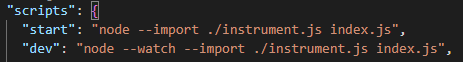
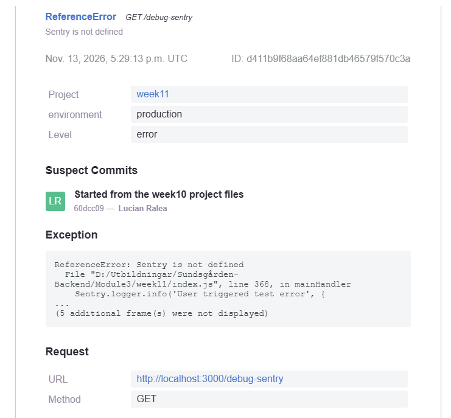
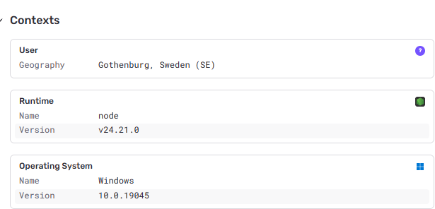
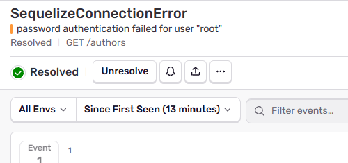

# Q&A
## 1. Why must instrument.js be imported before everything else?
There are obviously different ways to achieve the same behaviour with Sentry and the Sentry docs say to **use --import for ESM**. After this recommendation I created the structure I have at the moment, with a slightly modified **instrument.js**, without the need to put **import "./instrument.js" as the first line** in index.js and with the scripts part of package.json adapted to include **the --import flag** instead:  

## 2. Why do we keep the DSN in .env instead of in the code?
It's a good practice, although the hiding aspect is not as important in this case. Another reason would be that we can use the same code for different scenarios like a production setup and a development setup that only differ in the value Sentry value used.

## 3. What did Sentry recorded?
I would say alot. File name and location can be found in the e-mail received
  
For details, see information on the Sentry dashboard:  
  

## 4. What happened when the handler was above the routes?
In this version of sentry, this error could not be replicated, but I guess the answer is that Sentry does not report what it should.

## 5. Simulating connection failure?
After changing the password, all Insomnia route tests reported an error. I also received an e-mail from Sentry saying the same thing, but in more detail. Following the link, I saw that Sentry reported an **invalid password** as the failure reason. After returning to the correct password, everyhting went fine again and I tagged the issue as resolved  
  
Note: After received one e-mail from Sentry saying that I had an issue, nothing else got reported, although I changed the passwords back and forth trying to recreate the same password problem. It's hopeless.  

## 5. Why didn't the errors reach setupExpressErrorHandler by themselves?
No idea.

## 6. Several requests failed for the same reason. Did Sentry show them as separate issues, or group them?
I am sorry but I could not get Sentry to report more errors so I can not answer this question. Probably they were grouped, otherwise I see no meaning in having them tagged.

## 7. The difference between a breadcrumb and a tag?
I guess breadcrumbs leave traces to why the error appeared, while the tag is like a sticker on the error report so that we can group them together and assign them with more ease to group members (saying something like "Fix all issues tagged as XX").

## 7. what does each tool give you that the other doesn't?
Not sure what tool you mean except Sentry. But from what I can see all tools complement eachother, otherwise there would be no need of new tools doing the same thing. Well it actually would, if the new tools would become more efficient with every version. Sentry catches errors the other tools do not, such as connectivity problems (it's the only one thing I learned from this extremely tediuos exercise)