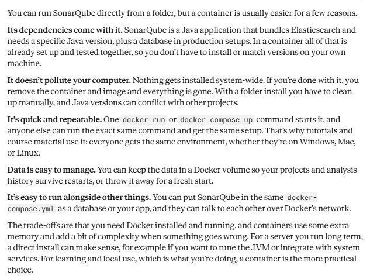

# Q&A
## 1. What does "docker ps" show you?  
The command shows us the docker processes served/started at the moment. We can see that sonarqube is running in the Image column and also that it runs on port 9000 in the Port(s) column.   

## 2. Why run sonarqube in a container instead of directly, from a computer folder?  
I got these reasons asking Claude  

