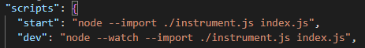
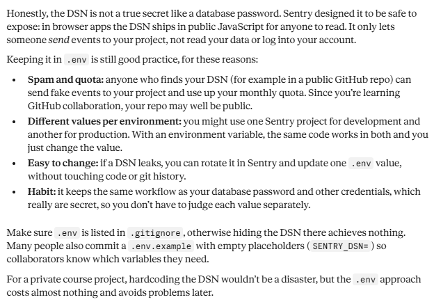
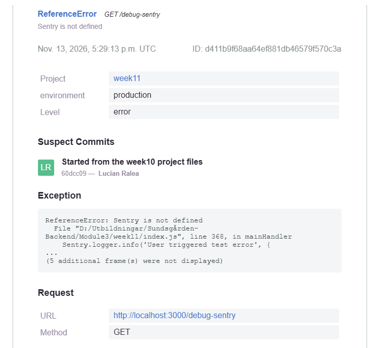
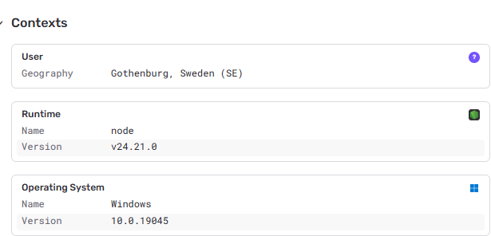

# Q&A
## 1. Why must instrument.js be imported before everything else?
There are obviously different ways to achieve the same behaviour with Sentry and the Sentry docs say to **use --import for ESM**. After this recommendation I created the structure I have at the moment, with a slightly modified **instrument.js**, without the need to put **import "./instrument.js" as the first line** in index.js and with the scripts part of package.json adapted to include **the --import flag** instead:  

## 2. Why do we keep the DSN in .env instead of in the code?
It's a good practice, although the hiding aspect is not as important in this case. See the explanation below from Claude:    

## 3. What did Sentry recorded?
I would say alot. File name and location can be found in the e-mail received
  
For details, see information on the Sentry dashboard:  
  

