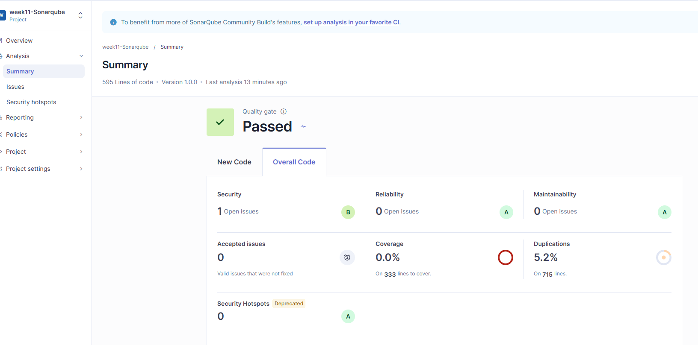

# SonarQube

## Task-1 Preparation
- Docker image for sonarqube downloaded
- compose.yml file created
- port added to .env
- scanner installed with dev dependency
- run scanner with these 3 commands (written as 1-liner to make it work):  
sonar-scanner-npm "-Dsonar.host.url=http://localhost:9000" "-Dsonar.token=your token" "-Dsonar.projectKey=items-project"  

## Task-2 The scan
The scan finnished successfully (see image below)  

